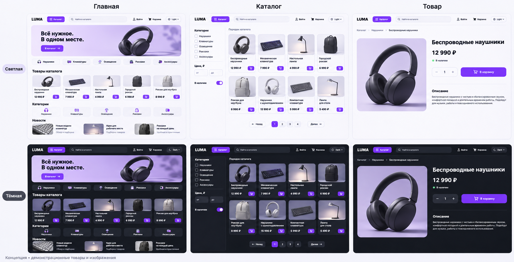

# Storefront Design Basis

<!-- START doctoc generated TOC please keep comment here to allow auto update -->
<!-- DON'T EDIT THIS SECTION, INSTEAD RE-RUN doctoc TO UPDATE -->

- [English](#english)
  - [Status and scope](#status-and-scope)
  - [Documents](#documents)
  - [Selected prototypes](#selected-prototypes)
  - [Maintenance](#maintenance)
- [Русский](#%D1%80%D1%83%D1%81%D1%81%D0%BA%D0%B8%D0%B9)
  - [Статус и область](#%D1%81%D1%82%D0%B0%D1%82%D1%83%D1%81-%D0%B8-%D0%BE%D0%B1%D0%BB%D0%B0%D1%81%D1%82%D1%8C)
  - [Документы](#%D0%B4%D0%BE%D0%BA%D1%83%D0%BC%D0%B5%D0%BD%D1%82%D1%8B)
  - [Выбранные прототипы](#%D0%B2%D1%8B%D0%B1%D1%80%D0%B0%D0%BD%D0%BD%D1%8B%D0%B5-%D0%BF%D1%80%D0%BE%D1%82%D0%BE%D1%82%D0%B8%D0%BF%D1%8B)
  - [Поддержка документации](#%D0%BF%D0%BE%D0%B4%D0%B4%D0%B5%D1%80%D0%B6%D0%BA%D0%B0-%D0%B4%D0%BE%D0%BA%D1%83%D0%BC%D0%B5%D0%BD%D1%82%D0%B0%D1%86%D0%B8%D0%B8)

<!-- END doctoc -->

## English

### Status and scope

Recorded on 2026-11-13 from the repository inspection and safe local API checks performed during the design investigation. This is a point-in-time record, not a guarantee about later deployments.

The selected visual direction is a minimal marketplace with violet accents, Inter typography, and light/dark themes. **LUMA is a working name**, not an approved production brand. Saving these materials approves documentation of the direction; it does not authorize implementation or backend changes. Exact layouts, mobile screens, and interaction details still need implementation-task acceptance criteria.

### Documents

| Document | Contents |
| --- | --- |
| [API analysis](api-analysis.md) | Backend/frontend architecture, endpoint inventory, response contracts, access rules, observed checks, gaps |
| [Page map](page-map.md) | Proposed routes, page components, API dependencies, support levels |
| [Design concept](design-concept.md) | Themes, tokens, layout, responsive behavior, component ownership, future delivery plan |
| [References](references.md) | Four external references, source links, local reference images, provenance and access limitations |

### Selected prototypes

[Open the original PNG](prototypes/storefront-light-dark.png). The board contains six desktop concepts: columns are home, catalog and product; the upper row is light and the lower row is dark. It is a raster concept generated during the investigation, not an editable Figma file or a screenshot of the running application.

Product photography, copy, names, categories and prices are demonstration content. API-dependent omissions and corrections to this illustration are recorded in the [design concept](design-concept.md). No separate mobile or tablet prototype was produced.

### Maintenance

Keep implemented behavior, observed deployment behavior and proposed changes separate. Recheck API contracts before implementation. Keep source citations and local images together; do not replace local previews with expiring chat links. All links in this documentation are relative to the repository, and no credentials or authentication tokens are stored here.

Markdown uses one document title, English/Russian language sections and nested subsections. TOC blocks are generated with the existing installed doctoc tool. Package scripts and configuration were intentionally left unchanged for this documentation-only task; these frontend documents are not yet included in the repository-wide `readme:toc` script.

## Русский

### Статус и область

Зафиксировано 2026-11-13 по результатам исследования репозитория и безопасных запросов к локальному API. Это снимок состояния на момент исследования, а не гарантия поведения последующих развёртываний.

Выбрано направление минималистичного маркетплейса с фиолетовым акцентом, Inter и светлой/тёмной темами. **LUMA — рабочее название**, не утверждённый бренд. Сохранение материалов согласует документирование направления, но не разрешает реализацию и изменения бэкенда. Точные макеты, мобильные экраны и взаимодействия требуют критериев приёмки отдельной задачи.

### Документы

| Документ | Содержание |
| --- | --- |
| [Анализ API](api-analysis.md) | Архитектура backend/frontend, endpoints, контракты ответов, доступ, проверки и пробелы |
| [Карта страниц](page-map.md) | Предлагаемые маршруты, компоненты, связь с API и уровень поддержки |
| [Дизайн-концепция](design-concept.md) | Темы, токены, компоновка, адаптивность, владение состоянием и план реализации |
| [Референсы](references.md) | Четыре внешних источника, ссылки, локальные изображения, происхождение и ограничения доступа |

### Выбранные прототипы

[Открыть исходный PNG](prototypes/storefront-light-dark.png). На листе шесть desktop-концептов: колонки — главная, каталог, товар; верхний ряд — Light, нижний — Dark. Это растровая концепция, сгенерированная при исследовании, не редактируемый Figma-файл и не скриншот работающего приложения.

Фотографии, тексты, названия, категории и цены демонстрационные. Ограничения API и поправки к иллюстрации описаны в [дизайн-концепции](design-concept.md). Отдельные mobile/tablet-прототипы не создавались.

### Поддержка документации

Отделять реализованное поведение от результатов проверки окружения и предложений. Перед реализацией сверить API заново. Хранить источники рядом с локальными изображениями, не заменять их временными ссылками чата. Ссылки относительны репозиторию; учётные данные и токены здесь не хранятся.

Markdown содержит один заголовок документа, языковые секции English/Русский и вложенные подразделы. Оглавления генерируются существующим установленным doctoc. Скрипты и конфигурация не менялись в рамках задачи только на документацию; эти frontend-документы пока не включены в общий `readme:toc`.
