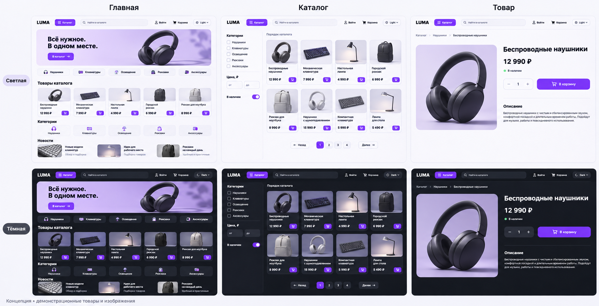

# Storefront Design Concept

<!-- START doctoc generated TOC please keep comment here to allow auto update -->
<!-- DON'T EDIT THIS SECTION, INSTEAD RE-RUN doctoc TO UPDATE -->

- [English](#english)
  - [Direction and prototype provenance](#direction-and-prototype-provenance)
  - [Visual tokens](#visual-tokens)
  - [Home](#home)
  - [Catalog](#catalog)
  - [Product detail](#product-detail)
  - [Responsive and accessible behavior](#responsive-and-accessible-behavior)
  - [Corrections to the raster board](#corrections-to-the-raster-board)
  - [Libraries, reuse and ownership](#libraries-reuse-and-ownership)
  - [Preliminary implementation sequence](#preliminary-implementation-sequence)
- [Русский](#%D1%80%D1%83%D1%81%D1%81%D0%BA%D0%B8%D0%B9)
  - [Направление и происхождение прототипа](#%D0%BD%D0%B0%D0%BF%D1%80%D0%B0%D0%B2%D0%BB%D0%B5%D0%BD%D0%B8%D0%B5-%D0%B8-%D0%BF%D1%80%D0%BE%D0%B8%D1%81%D1%85%D0%BE%D0%B6%D0%B4%D0%B5%D0%BD%D0%B8%D0%B5-%D0%BF%D1%80%D0%BE%D1%82%D0%BE%D1%82%D0%B8%D0%BF%D0%B0)
  - [Визуальные токены](#%D0%B2%D0%B8%D0%B7%D1%83%D0%B0%D0%BB%D1%8C%D0%BD%D1%8B%D0%B5-%D1%82%D0%BE%D0%BA%D0%B5%D0%BD%D1%8B)
  - [Главная](#%D0%B3%D0%BB%D0%B0%D0%B2%D0%BD%D0%B0%D1%8F)
  - [Каталог](#%D0%BA%D0%B0%D1%82%D0%B0%D0%BB%D0%BE%D0%B3)
  - [Карточка товара](#%D0%BA%D0%B0%D1%80%D1%82%D0%BE%D1%87%D0%BA%D0%B0-%D1%82%D0%BE%D0%B2%D0%B0%D1%80%D0%B0)
  - [Адаптивность и доступность](#%D0%B0%D0%B4%D0%B0%D0%BF%D1%82%D0%B8%D0%B2%D0%BD%D0%BE%D1%81%D1%82%D1%8C-%D0%B8-%D0%B4%D0%BE%D1%81%D1%82%D1%83%D0%BF%D0%BD%D0%BE%D1%81%D1%82%D1%8C)
  - [Поправки к растровому листу](#%D0%BF%D0%BE%D0%BF%D1%80%D0%B0%D0%B2%D0%BA%D0%B8-%D0%BA-%D1%80%D0%B0%D1%81%D1%82%D1%80%D0%BE%D0%B2%D0%BE%D0%BC%D1%83-%D0%BB%D0%B8%D1%81%D1%82%D1%83)
  - [Библиотеки, повторное использование и состояние](#%D0%B1%D0%B8%D0%B1%D0%BB%D0%B8%D0%BE%D1%82%D0%B5%D0%BA%D0%B8-%D0%BF%D0%BE%D0%B2%D1%82%D0%BE%D1%80%D0%BD%D0%BE%D0%B5-%D0%B8%D1%81%D0%BF%D0%BE%D0%BB%D1%8C%D0%B7%D0%BE%D0%B2%D0%B0%D0%BD%D0%B8%D0%B5-%D0%B8-%D1%81%D0%BE%D1%81%D1%82%D0%BE%D1%8F%D0%BD%D0%B8%D0%B5)
  - [Предварительная последовательность реализации](#%D0%BF%D1%80%D0%B5%D0%B4%D0%B2%D0%B0%D1%80%D0%B8%D1%82%D0%B5%D0%BB%D1%8C%D0%BD%D0%B0%D1%8F-%D0%BF%D0%BE%D1%81%D0%BB%D0%B5%D0%B4%D0%BE%D0%B2%D0%B0%D1%82%D0%B5%D0%BB%D1%8C%D0%BD%D0%BE%D1%81%D1%82%D1%8C-%D1%80%D0%B5%D0%B0%D0%BB%D0%B8%D0%B7%D0%B0%D1%86%D0%B8%D0%B8)

<!-- END doctoc -->

## English

### Direction and prototype provenance

Selected direction: the functional density of a large marketplace with quieter typography, spacing and decoration. Violet is reserved for primary actions, selected filters and focus. The temporary LUMA wordmark is exploratory. [References and attribution](references.md) describe the inspiration; the prototype is an original generated visual, not a copied template.

The preserved [original concept board](prototypes/storefront-light-dark.png) was generated with the built-in image generation tool during the investigation. No application code was produced. Six desktop views are preserved together in the original PNG; no separate page exports, Figma file, interaction prototype or mobile images were created.

| Board position | Page | Theme |
| --- | --- | --- |
| Top left | Home | Light |
| Top middle | Catalog | Light |
| Top right | Product detail | Light |
| Bottom left | Home | Dark |
| Bottom middle | Catalog | Dark |
| Bottom right | Product detail | Dark |

### Visual tokens

These are proposed implementation tokens; a raster generator does not guarantee exact hexadecimal output, font metrics or contrast compliance.

| Token | Light | Dark |
| --- | --- | --- |
| Accent/action | `#7C3AED` | `#7C3AED` |
| Page background | `#F7F7FA` | `#101116` |
| Card surface | `#FFFFFF` | `#191B23` |
| Main text | `#18181B` | `#F4F4F5` |
| Muted text | `#52525B` | `#A1A1AA` |
| Border | `#E4E4E7` | `#30323D` |
| Decorative hero | Pale lavender | Muted lavender, separately balanced text |

Inter is the target font, with a sans-serif fallback. Body text 14–16 px; page headings approximately 28–36 px; prices 20–28 px according to context. Use 12–16 px card radii, thin borders, restrained shadows and a 4/8 px spacing rhythm. Text, keyboard focus and interactive contrast must be verified during implementation, including violet controls in dark mode.

Provide Light / Dark / System in an accessible dropdown. System resolves through OS preference and reacts to changes until explicitly overridden. One theme source must drive both storefront CSS and retained Ant Design screens. Avoid a second unsynchronized theme store. Loading/initial rendering should avoid a disruptive theme flash; exact hydration behavior belongs to implementation.

### Home

Header: wordmark, catalog trigger, wide search, account/login, cart; notifications for an authenticated user. Keep search visually dominant. Category navigation leads to real API categories. A static editorial hero links to the catalog; it must not imply a campaign-management API.

Use “Catalog products” rather than “Popular” or “Recommended for you”. Category-based rows can use actual catalog queries. Do not infer bestsellers or popularity from `sort`. News uses title, brief and date. Banner copy and visuals are frontend editorial content, explicitly separated from API-driven product records.

### Catalog

Max-width container 1440 px. Desktop sidebar approximately 240 px; main grid has four columns alongside filters, or five when space permits without unreadable cards. Filters: categories, inclusive min/max price, stock toggle and removable selected-filter chips. Price units must be converted at the API boundary.

Keep filters and page in the URL so reload/back/share preserve selection. Search resets pagination deliberately. A compact toolbar may show the current query and a total only if supplied. “Catalog order” is informational; no functional sorting dropdown until backend support exists. Cards use one image/fallback, name, agreed price and add action. No ratings/hearts/delivery badges are implied.

For `{hasNextPage}` pagination show previous/next without a total. For `{total}` compute page count from total and limit; allow numbered pagination. Price type filters are technically possible but should not expose wholesale/VIP purchasing eligibility without an agreed business contract.

### Product detail

Two-column desktop composition: one large image/fallback on the left, title, effective price, availability, quantity and primary cart action on the right. Show description and linked categories below. A precise numeric ID remains the lookup key; any future decorative slug must not pretend a slug resolver exists.

No thumbnail gallery, variant selector, characteristics table, rating, review list, seller block, delivery promise or payment-installment option in the first version. Stock is summed availability, not a guarantee for a chosen store. Clicking add as a guest follows the approved login flow.

### Responsive and accessible behavior

| Viewport | Proposed behavior |
| --- | --- |
| Wide desktop | 1440 px maximum, 4–5 catalog columns as available; permanent filter sidebar |
| Tablet | 2–3 columns; collapsible/overlay filters; compressed header |
| Mobile | Two columns where readable, otherwise one; search on its own row; filters in Sheet; vertically stacked product detail |

Use practical touch targets around 44 px, labels for icon actions, visible focus, keyboard-operated menus/dialogs and reduced motion. Add a sticky product purchase area on mobile only if it remains usable with the keyboard and does not obscure content. Breakpoints and typography need actual device review; responsive rules are design intent, not existing validated screens.

### Corrections to the raster board

- All pictured products, prices, category examples, photos and news copy are demonstration data, not API exports.
- Product/category `pictureId` does not yet yield a documented URL. Use a clear fallback until the media contract/files exist; do not ship the illustration's sample photos as actual catalog images.
- Illustrated news thumbnails have no backing API field: first-version news cards are text-based.
- Numbered pagination in the illustration applies only to total-based responses; `hasNextPage` requires previous/next.
- The visible Light/Dark button represents a future three-choice Light/Dark/System menu; the current provider only has two modes.
- Product detail stays intentionally reduced: gallery/specifications/variants remain backend work.
- The board is not an exact asset, spacing or typography specification; tokens and verified contracts in these documents take precedence.

### Libraries, reuse and ownership

Retain Next.js, React, Tailwind, Refine and existing API/auth/i18n logic. Add shadcn/ui primitives and Lucide only in a separately approved implementation task. Ant Design can remain on current administrative/resource screens. next-themes is a candidate for System support; [official shadcn guidance](https://ui.shadcn.com/docs/dark-mode/next) demonstrates the integration. Reconcile the current `data-theme` CSS variant rather than assuming the new provider's default attribute matches it.

Candidate primitives: Button, Input, Card, Breadcrumb, Checkbox, Accordion, Sheet, Dropdown Menu, Dialog/Alert Dialog, Skeleton, Alert, Pagination and status feedback. Do not install a full commerce template with unrelated backend/payment assumptions.

Refine suits existing resource lists, notifications, order history and administrative screens. Compose home/catalog/product/cart/confirmation with ordinary Next.js/React components; these are scenario-driven views, not generic CRUD screens. Public discovery can use server rendering with explicit cache rules; user/session/cart/order data must not leak into shared caches. Exact fetching/cache policy requires a separate reviewed implementation decision.

Ownership: URL parameters own catalog filters/page; local controls own drafts/open state; the server cart owns persisted quantities; a session-scoped client coordinates refresh; a checkout coordinator handles submission/result; backend owns final prices, inventory and order transitions. Do not move all state into one root provider or pass a whole container into every component. Composition is enough for the distinct pages; an interface/registry per screen adds no current value. A small explicit status-to-label mapping remains clearer than polymorphic status objects.

### Preliminary implementation sequence

1. Approve first-version scope, exact copy, brand and browser deployment/auth policy.
2. Resolve media, effective-price/currency, checkout idempotency and stock-restoration gates; agree reduced checkout behavior.
3. Create a separate frontend task with acceptance criteria and preservation of existing routes/working features.
4. Implement storefront shell, tokens, theme synchronization and responsive navigation.
5. Integrate catalog/categories/search/detail and URL filter serialization.
6. Integrate cart, confirmation and snapshot-backed order history after API gates.
7. Adapt existing login/news/notifications; keep registration/recovery hidden until supported.
8. Verify TypeScript, meaningful API-client tests, browser scenarios, keyboard access and responsive states. Respect the project's prohibition on frontend build commands during agent verification.

This sequence is planning only. No pages, components, dependencies, backend fixes or configuration changes are implemented by this documentation.

## Русский

### Направление и происхождение прототипа

Выбрано направление функционально плотного маркетплейса со спокойной типографикой, отступами и декором. Фиолетовый используется для основных действий, выбранных фильтров и focus. LUMA — временный wordmark. [Референсы](references.md) фиксируют вдохновение; прототип — оригинальное сгенерированное изображение, не копия шаблона.

[Исходный лист](prototypes/storefront-light-dark.png) создан встроенным image generation при исследовании. Код приложения не генерировался. Шесть desktop-экранов сохранены вместе в оригинальном PNG; отдельных экспортов, Figma, интерактивного прототипа и mobile-изображений нет.

| Положение | Страница | Тема |
| --- | --- | --- |
| Сверху слева | Главная | Light |
| Сверху в центре | Каталог | Light |
| Сверху справа | Товар | Light |
| Снизу слева | Главная | Dark |
| Снизу в центре | Каталог | Dark |
| Снизу справа | Товар | Dark |

### Визуальные токены

Токены предлагаются для реализации: растровая генерация не гарантирует точные hex, метрики шрифта и контраст.

| Токен | Light | Dark |
| --- | --- | --- |
| Акцент/действие | `#7C3AED` | `#7C3AED` |
| Фон | `#F7F7FA` | `#101116` |
| Карточка | `#FFFFFF` | `#191B23` |
| Основной текст | `#18181B` | `#F4F4F5` |
| Вторичный текст | `#52525B` | `#A1A1AA` |
| Граница | `#E4E4E7` | `#30323D` |
| Декоративный hero | Светлая лаванда | Приглушённая лаванда с отдельно подобранным текстом |

Шрифт Inter с sans-serif fallback; основной текст 14–16 px, заголовки примерно 28–36 px, цены 20–28 px. Радиусы 12–16 px, тонкие границы, умеренные тени, шаг отступов 4/8 px. Контраст текста, focus и фиолетовых контролов проверить при реализации.

Темы Light/Dark/System доступны из dropdown. System следует OS и реагирует на изменения до явного выбора. Один источник темы управляет CSS витрины и сохранёнными Ant Design-экранами. Не создавать независимые theme stores. Предусмотреть начальный рендер без резкого мигания; hydration решается в реализации.

### Главная

Шапка: логотип, каталог, широкий поиск, аккаунт/вход, корзина; авторизованному — уведомления. Поиск визуально главный. Категории ведут к реальным разделам API. Статический editorial-баннер ведёт в каталог и не обещает API управления кампаниями.

Заголовок «Товары каталога», без «Популярное» и «Рекомендуем вам». Подборки категорий используют реальные запросы; `sort` не означает популярность. Новости показывают название, анонс, дату. Баннер и его оформление — отдельный статический контент frontend.

### Каталог

Контейнер до 1440 px, sidebar около 240 px. Четыре колонки с фильтрами, пять при достаточном месте. Фильтры: категории, минимальная/максимальная цена, наличие, chips сброса. Денежные единицы переводятся на границе API.

Фильтры и страница хранятся в URL для reload/back/share; поиск явно сбрасывает пагинацию. Toolbar показывает запрос и total только при наличии. «Порядок каталога» — подпись, не dropdown сортировки. Карточка: изображение/fallback, название, согласованная цена, добавление. Нет рейтингов, избранного и delivery badges.

При `hasNextPage` — «Назад/Далее» без total. При total — вычисление страниц из total/limit и возможная нумерация. Типы цен технически фильтруются, но WHOLESALE/VIP не должны обещать право покупки по ним без бизнес-контракта.

### Карточка товара

Desktop: слева одно крупное изображение/fallback, справа название, эффективная цена, наличие, количество и CTA. Ниже описание и категории. Lookup по числовому ID; декоративный slug в будущем не заменяет отсутствующий slug resolver.

В первой версии нет thumbnails, вариантов, таблицы характеристик, рейтинга, отзывов, продавца, обещаний доставки и рассрочки. Наличие суммарное, не для выбранного магазина. Гость переходит в согласованный login-flow.

### Адаптивность и доступность

| Экран | Предлагаемое поведение |
| --- | --- |
| Широкий desktop | Максимум 1440 px, 4–5 колонок по месту, постоянный sidebar |
| Tablet | 2–3 колонки, сворачиваемые/overlay фильтры, компактная шапка |
| Mobile | Две колонки при читаемости, иначе одна; поиск отдельной строкой; Sheet фильтров; вертикальный товар |

Область нажатия около 44 px, подписи icon-actions, видимый focus, keyboard-доступность меню/dialog и reduced motion. Sticky-покупка на mobile допустима после проверки клавиатуры и перекрытия контента. Breakpoints/типографика требуют проверки устройств: это намерение дизайна, не готовые проверенные экраны.

### Поправки к растровому листу

- Товары, цены, категории, фотографии и новости демонстрационные, не выгружены из API.
- `pictureId` не даёт документированного URL. До media-контракта использовать fallback; фото иллюстрации не выдавать за реальные товары.
- У новостей нет поля обложки: в первой версии текстовые карточки.
- Нумерация страниц подходит только total-ответам; при `hasNextPage` — «Назад/Далее».
- Кнопка Light/Dark обозначает будущее меню Light/Dark/System; сейчас provider двухрежимный.
- Сокращённый товар намеренный: галерея/характеристики/варианты требуют backend.
- Изображение не задаёт точные assets/отступы/метрики; текстовые токены и проверенные контракты приоритетнее.

### Библиотеки, повторное использование и состояние

Сохранить Next.js, React, Tailwind, Refine и API/auth/i18n. shadcn/ui и Lucide добавить только отдельной задачей. Ant Design оставить на существующих admin/resource-экранах. Для System рассмотреть next-themes; [официальный shadcn](https://ui.shadcn.com/docs/dark-mode/next) описывает интеграцию. Согласовать атрибут темы с существующим `data-theme`, не предполагать совпадение defaults.

Примитивы: Button, Input, Card, Breadcrumb, Checkbox, Accordion, Sheet, Dropdown Menu, Dialog/Alert Dialog, Skeleton, Alert, Pagination и feedback статусов. Не устанавливать полный commerce template с чужой оплатой/бэкендом.

Refine подходит спискам, уведомлениям, истории заказов, admin UI. Главную/каталог/товар/корзину/подтверждение собирать обычными Next.js/React-компонентами: сценарии не сводятся к CRUD. Для публичной выдачи возможен server rendering с явным cache policy; персональные данные не должны попадать в общий cache. Точная политика требует отдельного решения.

URL владеет фильтрами/страницей, локальные контролы — draft/open, серверная корзина — сохранённым количеством, session client — refresh, checkout coordinator — отправкой/результатом, backend — ценами/остатками/переходами. Не складывать всё в root provider и не передавать контейнер каждому компоненту. Для страниц достаточно композиции; interface/registry на экран не нужны. Простое отображение status→label яснее полиморфных объектов статуса.

### Предварительная последовательность реализации

1. Согласовать объём, тексты, бренд, размещение frontend/API и auth policy.
2. Решить media, цену/валюту, идемпотентность и возврат остатков; согласовать сокращённый checkout.
3. Создать отдельную frontend-задачу с критериями и сохранением маршрутов/рабочих функций.
4. Реализовать shell, токены, синхронизацию тем, адаптивную навигацию.
5. Подключить каталог/категории/поиск/товар и сериализацию URL-фильтров.
6. После API-условий подключить корзину, подтверждение, историю по снимкам.
7. Адаптировать login/news/notifications, скрыть регистрацию/recovery до API.
8. Проверить TypeScript, значимые API-client tests, браузерные сценарии, клавиатуру и адаптивность. Соблюдать запрет агенту запускать frontend build.

Это только план. Документация не реализует страницы, компоненты, зависимости, backend-исправления и конфигурацию.
