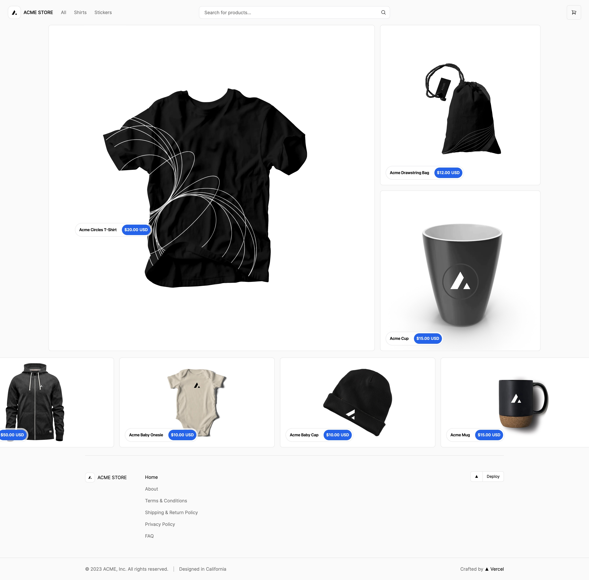
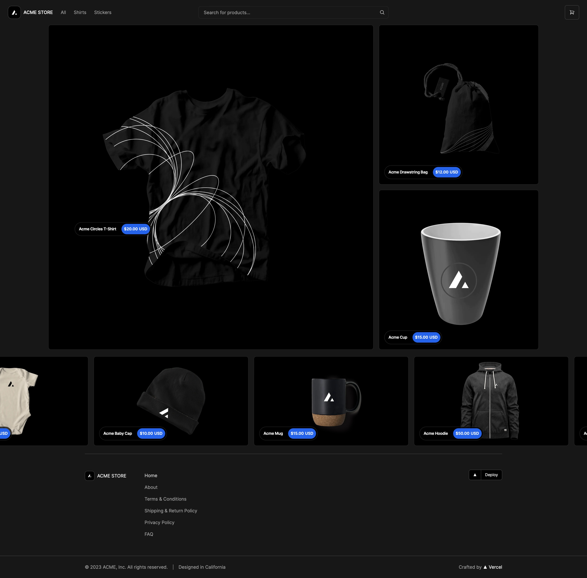

# Storefront Visual References

<!-- START doctoc generated TOC please keep comment here to allow auto update -->
<!-- DON'T EDIT THIS SECTION, INSTEAD RE-RUN doctoc TO UPDATE -->

- [English](#english)
  - [Sources and selection](#sources-and-selection)
  - [Preserved Vercel images](#preserved-vercel-images)
  - [Selected original concept](#selected-original-concept)
  - [Implementation documentation sources](#implementation-documentation-sources)
- [Русский](#%D1%80%D1%83%D1%81%D1%81%D0%BA%D0%B8%D0%B9)
  - [Источники и выбор](#%D0%B8%D1%81%D1%82%D0%BE%D1%87%D0%BD%D0%B8%D0%BA%D0%B8-%D0%B8-%D0%B2%D1%8B%D0%B1%D0%BE%D1%80)
  - [Сохранённые изображения Vercel](#%D1%81%D0%BE%D1%85%D1%80%D0%B0%D0%BD%D1%91%D0%BD%D0%BD%D1%8B%D0%B5-%D0%B8%D0%B7%D0%BE%D0%B1%D1%80%D0%B0%D0%B6%D0%B5%D0%BD%D0%B8%D1%8F-vercel)
  - [Выбранная оригинальная концепция](#%D0%B2%D1%8B%D0%B1%D1%80%D0%B0%D0%BD%D0%BD%D0%B0%D1%8F-%D0%BE%D1%80%D0%B8%D0%B3%D0%B8%D0%BD%D0%B0%D0%BB%D1%8C%D0%BD%D0%B0%D1%8F-%D0%BA%D0%BE%D0%BD%D1%86%D0%B5%D0%BF%D1%86%D0%B8%D1%8F)
  - [Технические источники для реализации](#%D1%82%D0%B5%D1%85%D0%BD%D0%B8%D1%87%D0%B5%D1%81%D0%BA%D0%B8%D0%B5-%D0%B8%D1%81%D1%82%D0%BE%D1%87%D0%BD%D0%B8%D0%BA%D0%B8-%D0%B4%D0%BB%D1%8F-%D1%80%D0%B5%D0%B0%D0%BB%D0%B8%D0%B7%D0%B0%D1%86%D0%B8%D0%B8)

<!-- END doctoc -->

## English

### Sources and selection

References were researched online during the 2026-11-13 investigation. They inform visual decisions, not application API capabilities. Reuse of external source code/assets needs the applicable source license; saving screenshots for design reference does not establish redistribution or production-asset rights. No paid blocks or accounts were accessed.

| Reference | Source | Useful decisions | Access and limits |
| --- | --- | --- | --- |
| Vercel Next.js Commerce | [Official article](https://vercel.com/blog/introducing-next-js-commerce-2-0), [template](https://examples.vercel.com/templates/template/nextjs-commerce) | Quiet product surfaces, image emphasis, simple header, equivalent light/dark hierarchy | Official images preserved below; live demo at `https://demo.vercel.store/` failed to open during investigation |
| Tailwind UI Ecommerce | [Official public overview](https://tailwindcss.com/blog/tailwind-ui-ecommerce) | Product-page hierarchy, category/filter composition, spacing | Public overview available; detailed Plus product-list/product-overview routes redirected to login; no paid source downloaded |
| Shadcn Space Product Listing | [Product listing examples](https://shadcnspace.com/blocks/ecommerce/product-listing) | Compact multicolumn grid, readable prices/names, small purchase actions | Public descriptions/previews; includes free and Pro variants; retained as source link, no local screenshot captured |
| ShadcnStore Product Overview | [Product detail collection](https://shadcnstore.com/blocks/e-commerce/product-overview) | Image/buy-box separation, understated borders and controls | Public collection includes free and Pro variants; retained as source link, no local screenshot captured |

Do not adopt unsupported reference features such as reviews, wishlist, color variants, shipping promises or payment flows. shadcn-related third-party collections are independent of the core shadcn/ui project.

### Preserved Vercel images

Source publication: [Introducing Next.js Commerce 2.0](https://vercel.com/blog/introducing-next-js-commerce-2-0), credited there to Michael Novotny and Lee Robinson. Images were downloaded unmodified from the publication's public image endpoints on 2026-11-13.

| Local file | Original image URL |
| --- | --- |
| [Light image](references/vercel-commerce-light.jpg) | [Contentful original](https://images.ctfassets.net/e5382hct74si/6RWgAVUNSV53QlfMilndOF/851ce4a4a1630aa43d553e8995cc0970/design-light.jpg) |
| [Dark image](references/vercel-commerce-dark.jpg) | [Vercel image endpoint](https://assets.vercel.com/image/upload/contentful/image/e5382hct74si/692COcVU9KjIrx9rLsiOZi/b0fd734ee1b9846c846f89ca791a1ed5/design-dark.jpg) |

### Selected original concept

[Storefront board](prototypes/storefront-light-dark.png): an original image generated with the built-in image generation tool, retained in its original PNG form. Top row: light home/catalog/product; bottom row: dark home/catalog/product. It is a design proposal with demonstration content, not a third-party screenshot, API data export or application implementation. No external reference image was supplied as an edit target.

The generation brief specified Inter-like typography, violet `#7C3AED`, quiet rounded cards, a search-led header, a five-card home row, a four-column catalog with category/price/stock filters, and a product view with one image, price, stock, quantity and add action. It excluded ratings, wishlist, variants, specifications, delivery/payment promises and sorting controls. See [concept corrections](design-concept.md) for remaining raster-only details that must not become unsupported features.

### Implementation documentation sources

[shadcn/ui Next.js dark-mode guide](https://ui.shadcn.com/docs/dark-mode/next) is the primary source for the proposed next-themes integration. This is technical guidance, not a fifth visual reference. Library installation and theme-provider changes remain outside this documentation task.

## Русский

### Источники и выбор

Референсы найдены в интернете при исследовании 2026-11-13. Они определяют визуальное направление, не возможности API. Использование чужого кода/assets требует соблюдения лицензии источника; сохранение изображения для исследования не устанавливает права на распространение и production-assets. Платные блоки и аккаунты не использовались.

| Референс | Источник | Полезные решения | Доступ и ограничения |
| --- | --- | --- | --- |
| Vercel Next.js Commerce | [Официальная статья](https://vercel.com/blog/introducing-next-js-commerce-2-0), [шаблон](https://examples.vercel.com/templates/template/nextjs-commerce) | Спокойные товарные поверхности, акцент на изображении, простая шапка, Light/Dark | Официальные изображения сохранены ниже; live demo `https://demo.vercel.store/` при исследовании не открылось |
| Tailwind UI Ecommerce | [Публичный обзор автора](https://tailwindcss.com/blog/tailwind-ui-ecommerce) | Иерархия товара, категории/фильтры, отступы | Обзор доступен; детальные Plus-разделы product-list/product-overview перенаправляли на login; платный код не скачивался |
| Shadcn Space Product Listing | [Примеры выдачи](https://shadcnspace.com/blocks/ecommerce/product-listing) | Компактная сетка, читаемые названия/цены, небольшие действия | Публичные описания/preview, есть Free/Pro; сохранена ссылка, локальный скриншот не получен |
| ShadcnStore Product Overview | [Коллекция карточек товара](https://shadcnstore.com/blocks/e-commerce/product-overview) | Разделение изображения/покупки, спокойные границы и контролы | Коллекция Free/Pro; сохранена ссылка, локальный скриншот не получен |

Не переносить неподдерживаемые отзывы, избранное, варианты цвета, обещания доставки и оплату. Сторонние shadcn-коллекции независимы от основного проекта shadcn/ui.

### Сохранённые изображения Vercel

Публикация: [Introducing Next.js Commerce 2.0](https://vercel.com/blog/introducing-next-js-commerce-2-0), авторы Michael Novotny и Lee Robinson. Изображения скачаны без изменений из публичных image endpoints публикации 2026-11-13.

| Локальный файл | Исходное изображение |
| --- | --- |
| [Светлое](references/vercel-commerce-light.jpg) | [Contentful original](https://images.ctfassets.net/e5382hct74si/6RWgAVUNSV53QlfMilndOF/851ce4a4a1630aa43d553e8995cc0970/design-light.jpg) |
| [Тёмное](references/vercel-commerce-dark.jpg) | [Vercel image endpoint](https://assets.vercel.com/image/upload/contentful/image/e5382hct74si/692COcVU9KjIrx9rLsiOZi/b0fd734ee1b9846c846f89ca791a1ed5/design-dark.jpg) |

### Выбранная оригинальная концепция

[Лист витрины](prototypes/storefront-light-dark.png) — оригинальное изображение встроенного image generation, сохранённое как исходный PNG. Сверху Light главная/каталог/товар, снизу те же страницы Dark. Это предложение с демонстрационным содержимым, не чужой скриншот, не экспорт API и не реализация. Внешние изображения не передавались как edit targets.

Бриф генерации: Inter-подобная типографика, `#7C3AED`, спокойные скруглённые карточки, шапка с поиском, пять товаров на главной, четыре колонки выдачи с категориями/ценой/наличием, товар с одним изображением/ценой/наличием/количеством/CTA. Исключены рейтинги, избранное, варианты, характеристики, обещания доставки/оплаты и сортировка. Оставшиеся условности растрового изображения перечислены в [концепции](design-concept.md) и не должны становиться неподдерживаемыми функциями.

### Технические источники для реализации

[Официальный shadcn/ui Next.js dark-mode guide](https://ui.shadcn.com/docs/dark-mode/next) — первичный источник предлагаемой интеграции next-themes. Это техническое руководство, не пятый визуальный референс. Установка и изменение provider не входят в задачу документации.
